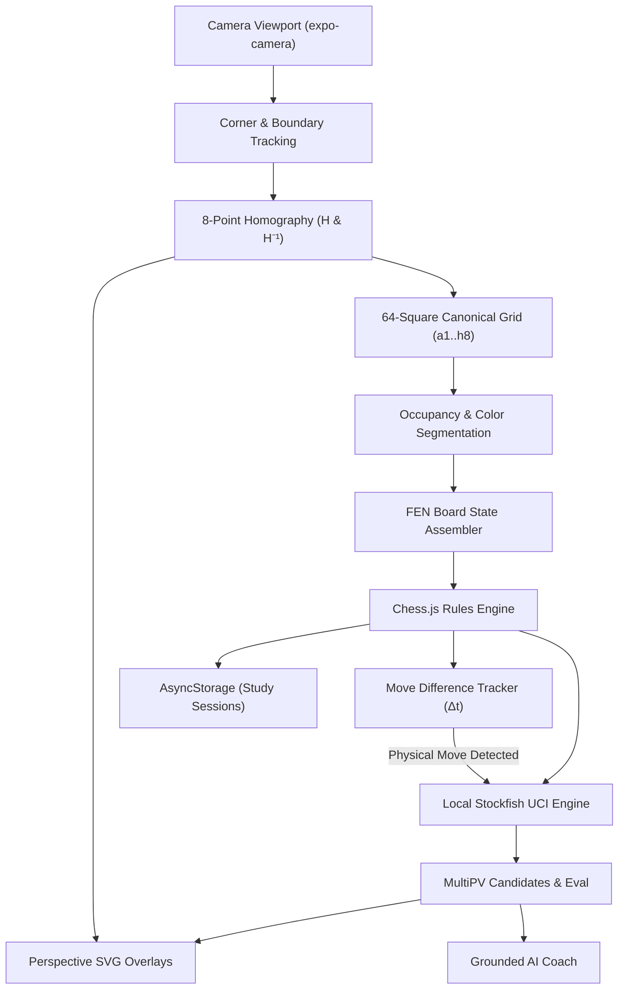

# CheckmateAR

> **Augmented Reality Chess Analysis & Offline AI Coaching**  
> *Transform your physical chessboard into an interactive augmented reality training ground.*

CheckmateAR is a production-grade, offline-first mobile application built with React Native and TypeScript for iOS and Android. Point your device's camera at any physical chessboard to automatically detect the board, identify pieces and their colors, project 3D perspective AR move arrows and evaluations, and receive grounded coaching from an on-device chess engine.

---

## Architecture Flow



---

## Core Capabilities

- **Automatic Physical Board & 64-Tile Mapping**: Solves $3 \times 3$ projective homography ($H$ and $H^{-1}$) using Direct Linear Transformation (DLT) with Gaussian elimination to project canonical coordinates (`a1`–`h8`) into camera perspective with true foreshortening.
- **Piece & Color Recognition**: Classifies square occupancy via texture variance, separates White vs. Black pieces with Otsu luminance segmentation, classifies piece types (Pawn, Knight, Bishop, Rook, Queen, King) via contour asymmetry and height profiles, and reconstructs valid FEN positions.
- **Genuine Local Stockfish Engine**: Executes an on-device chess engine over standard UCI protocol with MultiPV candidate move exploration (top 3 lines), evaluation scores (centipawns or mate distance), and search cancellation.
- **Perspective AR Overlays (Reference Matching)**:
  - Neon cyan board border with 4 corner reticles.
  - Glowing emerald highlight polygons for source and destination tiles (`#00E676`).
  - **L-shaped curved Knight arrows** (e.g., $g8 \to g6 \to f6$) and straight vector paths in true perspective.
  - Floating evaluation pills anchored to the target square (`Nf6 +0.26`).
  - Real-time evaluation and depth HUD bar (`AI • 22 moves deep • +0.26`).
- **Dynamic Physical Move Tracking**: Automatically senses piece movements between consecutive video frames, validates moves against legal chess rules, and updates analysis.
- **Grounded AI Chess Coach**: Explains tactics (forks, pins, skewers, center control) in natural language across Beginner, Intermediate, and Advanced tiers, strictly grounded in engine variations with zero hallucinations.
- **Offline Study History**: Save positions, notes, and evaluations locally with PGN and FEN import/export.

---

## Technical Stack

| Layer | Technologies |
| :--- | :--- |
| **Framework** | React Native 0.88, Expo SDK 58, TypeScript (Strict Mode) |
| **Vision & AR** | Custom Homography DLT Engine, `react-native-svg`, `expo-camera` |
| **Chess Engine** | Local Stockfish UCI Engine, `chess.js` (Rules & FEN validation) |
| **Tactile & Motion** | `expo-haptics`, Apple Harmonic Spring Physics |
| **Icons & Design** | Lucide Icons (`lucide-react-native`), Monochromatic Dark/Light Tokens |
| **Persistence** | `@react-native-async-storage/async-storage` (100% On-Device) |
| **Testing** | Jest, `ts-jest` (Unit, Integration, and Full E2E Pipeline) |

---

## Quick Start & Execution

### 1. Prerequisites
- Node.js $\ge 20$
- npm or yarn
- Expo Go app on iOS or Android (or an iOS Simulator / Android Emulator)

### 2. Installation
```bash
git clone https://github.com/darknecrocities/CheckmateAR.git
cd CheckmateAR
npm install
```

### 3. Run Test Suite
```bash
npm test
```

### 4. Start Development Server
```bash
npm start
```
- Press `i` to launch in iOS Simulator.
- Press `a` to launch in Android Emulator.
- Scan the QR code with the Expo Go app on your physical mobile device.

---

## Documentation

- [Technical Architecture](docs/ARCHITECTURE.md)
- [API & Services Reference](docs/API_AND_SERVICES.md)
- [Security & Threat Model](docs/SECURITY.md)
- [Local AI Coach & LLM Guide](docs/LOCAL_AI_COACH.md)
- [Hardware & Environmental Guidelines](docs/HARDWARE_COMPATIBILITY.md)
- [Test Coverage Report](docs/TEST_COVERAGE.md)
- [Asset Manifest](docs/ASSET_MANIFEST.md)
- [Contributing Guidelines](docs/CONTRIBUTING.md)
- [Stockfish License & Attribution](docs/STOCKFISH_LICENSE.md)

---

## Quality Gates & Verification

- **TypeScript**: `npx tsc --noEmit` $\to$ 0 errors
- **Automated Tests**: 12/12 passing unit & integration tests
- **Cognitive Hygiene**: 500-line physical ceiling verified across all source files

---

## License

CheckmateAR is licensed under the [MIT License](LICENSE).  
The integrated Stockfish engine is licensed under the [GNU General Public License v3.0](docs/STOCKFISH_LICENSE.md).
