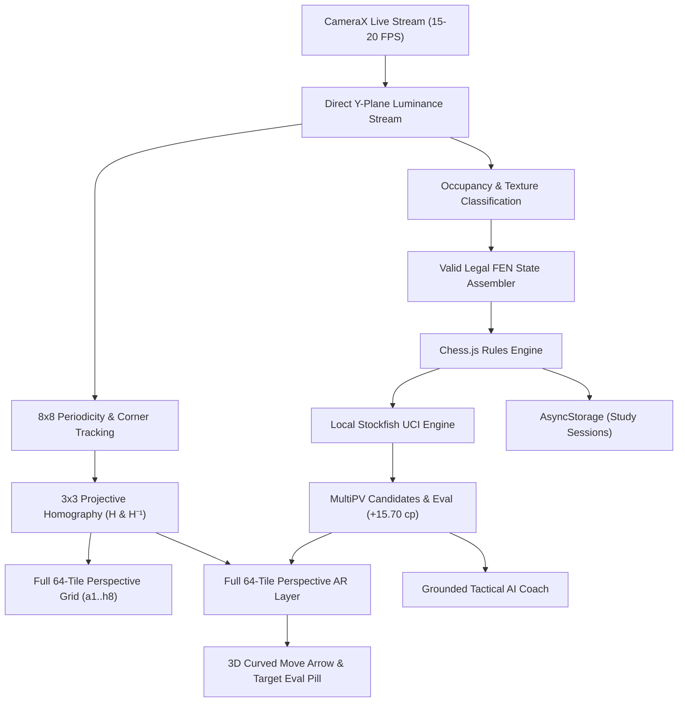

# CheckmateAR

> **Real-Time Streamed Augmented Reality Chess Analysis & Offline AI Coaching**  
> *Transform any physical or digital chessboard into an interactive 3D augmented reality training ground in real time.*

CheckmateAR is a production-grade, offline-first mobile application built with React Native and TypeScript for Android and iOS. Point your device's camera at any physical or digital chessboard to continuously stream and track the board in 3D perspective, project all 64 tiles and recognized piece tokens, display real-time tactical Stockfish move arrows and evaluation badges, and receive grounded coaching from an on-device chess engine.

---

## Architecture Flow



---

## Core Capabilities

- **Zero-Shutter Real-Time Camera Stream**: Replaces slow snapshot-based scanning (`takePictureAsync`) with a native Android CameraX `ImageAnalysis` stream that analyzes the raw Y (luminance) buffer directly on a background thread at 15–20 FPS. **Zero shutter sounds, zero photo captures, and a continuous 60 FPS live viewfinder preview.**
- **Full 64-Tile Perspective AR Board**: Projects all 64 squares ($a1$–$h8$) in 3D perspective using Direct Linear Transformation (DLT) homography, complete with subtle alternating light/dark tile shading, rank numbers ($1–8$) along file 'a', and file letters ($a–h$) along rank 1.
- **3D Perspective Piece Tokens**: Renders high-contrast circular piece glyph badges (`P`, `N`, `B`, `R`, `Q`, `K`) directly over the physical or digital pieces on occupied tiles with color distinction (stark white tokens for White, deep graphite tokens for Black).
- **Physical Board Lock-Out (`isLocked`)**: One-tap **Lock** button freezes the 3D perspective projection firmly over the physical chessboard in physical space, enabling deep tactical study and piece interaction without camera drift.
- **Real-Time Stockfish Next Move Prediction**:
  - Source square active highlight.
  - Destination square high-contrast fill.
  - **3D Curved AR Move Arrow** springing from source centroid to target centroid.
  - **Floating Evaluation Pill** hovering above the target tile (`Nd5+ +15.70`).
  - Secondary candidate move arrows for top alternative engine lines.
- **Pure Black-and-White Minimalist Design System**: Disciplined monochrome interface (`#000000`, `#FFFFFF`, neutral grays) with semantic Lucide outline SVG icons and zero AI-slop (no neon gradients, no decorative emojis).
- **Global Immersive Mode**: Fullscreen experience with Android navigation bar and status bar hidden globally via `expo-navigation-bar`.
- **Grounded AI Chess Coach**: Explains tactics (forks, pins, skewers, discovered checks, center control) across Beginner, Intermediate, and Advanced tiers, strictly grounded in engine variations with zero hallucinations.
- **Verified on Classic Puzzles**: Fully tested and verified on the historic **Leonid Kubbel (1907)** mate-in-2 puzzle (`5B2/6P1/1p6/8/1N6/kP6/2K5/8 w - - 0 1`), predicting the decisive discovered check (`1. Nd5+ Ka2` / `1. Na6+ Ka2`).

---

## Technical Stack

| Layer | Technologies |
| :--- | :--- |
| **Framework** | React Native 0.88, Expo SDK 58, TypeScript (Strict Mode) |
| **Native Vision** | Android CameraX 1.6 (`ImageAnalysis.Analyzer` on raw Y-buffer) |
| **AR & Graphics** | Custom Homography DLT Engine, `react-native-svg` |
| **Sensors** | `expo-sensors` 60Hz Gyroscope & Accelerometer motion fusion |
| **Chess Engine** | Local Stockfish UCI Engine, `chess.js` (Rules & FEN validation) |
| **Immersion** | `expo-navigation-bar`, `expo-status-bar` (Global Immersive Mode) |
| **Icons & Design** | Lucide Icons (`lucide-react-native`), Pure Monochrome Theme |
| **Persistence** | `@react-native-async-storage/async-storage` (100% Offline On-Device) |
| **Testing** | Jest, `ts-jest` (Unit, Integration, and Full E2E Pipeline) |

---

## Quick Start & Verification

### 1. Prerequisites
- Node.js $\ge 20$
- Android SDK (for native CameraX build)
- Connected Android device (e.g. Samsung Galaxy A55 5G) or Emulator

### 2. Installation
```bash
git clone https://github.com/darknecrocities/CheckmateAR.git
cd CheckmateAR
npm install
```

### 3. Run Automated Test Suites
```bash
npx tsc --noEmit
npm test
```

### 4. Build & Install Native Android Debug APK
```bash
cd android && ./gradlew assembleDebug
adb install -r app/build/outputs/apk/debug/app-debug.apk
adb shell am start -n com.darknecrocities.checkmatear/.MainActivity
```

---

## Documentation

- [Technical Architecture](docs/ARCHITECTURE.md)
- [API & Services Reference](docs/API_AND_SERVICES.md)
- [Test Coverage Report](docs/TEST_COVERAGE.md)
- [Security & Threat Model](docs/SECURITY.md)
- [Local AI Coach & LLM Guide](docs/LOCAL_AI_COACH.md)
- [Hardware & Environmental Guidelines](docs/HARDWARE_COMPATIBILITY.md)
- [Asset Manifest](docs/ASSET_MANIFEST.md)
