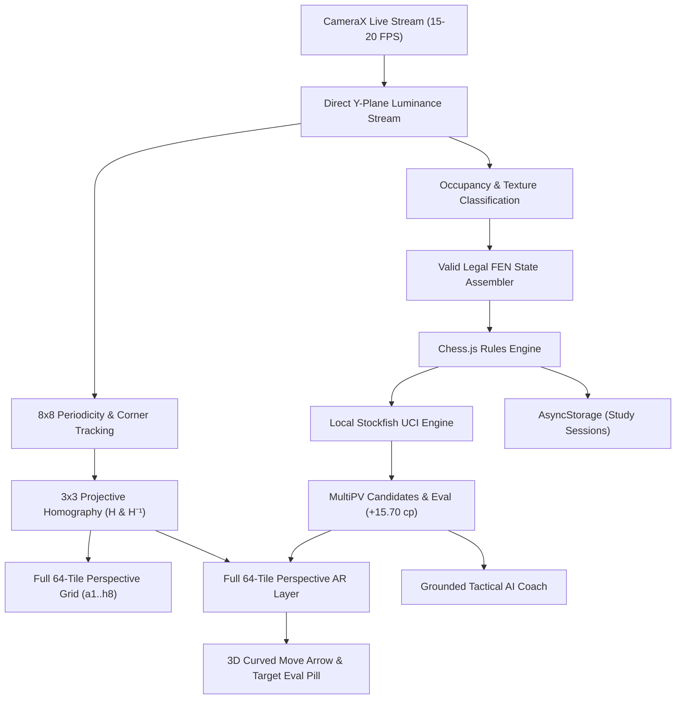

# CheckmateAR — Technical Architecture Document

## 1. Overview
CheckmateAR is an offline-first mobile application built with React Native and TypeScript that transforms any physical or digital chessboard into an interactive augmented reality coaching environment in real time.

## 2. Real-Time Camera Stream Architecture (Zero Shutter Snaps)
1. **CameraX ImageAnalysis Pipeline**: Implemented in native Android (`LiveCameraView.kt`) using `androidx.camera.core.ImageAnalysis`.
2. **Direct Buffer Processing**: Analyzes the raw Y (luminance) plane directly from `ImageProxy` memory at 15–20 FPS on a background thread.
3. **Zero Shutter Latency**: Eliminates all `takePictureAsync` photo captures, shutter clicks, and viewfinder freezing.
4. **Sensor Fusion**: Integrates 60Hz gyroscope and accelerometer data (`CameraMotionTracker`) with velocity dampening to maintain perspective stability across camera translation and rotation.

## 3. Computer Vision & Homography Math
Given 4 physical board corner coordinates $C_{src} = [P_0, P_1, P_2, P_3]$ in camera screen pixels:
1. Canonical space is defined as an $800 \times 800$ square with origin $(0, 0)$.
2. The $3 \times 3$ projective homography matrix $H$ is computed via Direct Linear Transformation (DLT) with Gaussian elimination and partial pivoting.
3. Every canonical tile $S_{col, row}$ has 4 vertices $[(c \cdot 100, r \cdot 100), \dots]$.
4. The forward transform $P_{screen} = H \cdot P_{canonical}$ projects each tile's corners and center onto the camera screen with true perspective foreshortening.

## 4. Full 64-Tile Perspective AR Layer
1. **64 Perspective Tiles**: Renders every square ($a1$ to $h8$) with alternating contrast polygon shading (`rgba(255, 255, 255, 0.08)` and `rgba(0, 0, 0, 0.22)`).
2. **Edge Coordinate Labels**: Perspective rank numbers ($1–8$) along file 'a' and file letters ($a–h$) along rank 1.
3. **Piece Glyphs**: High-contrast circular tokens (`N`, `B`, `R`, `Q`, `K`, `P`) positioned at the perspective centroid of occupied tiles.
4. **Board Lock-Out**: High-contrast stark white double-border when locked, freezing coordinates in space.
5. **Tactical Move Arrows**:
   - Source square active highlight and destination square fill.
   - 3D curved AR move arrow connecting source centroid to destination centroid.
   - Floating evaluation pill hovering directly over the destination tile (`Nd5+ +15.70`).

## 5. Offline & Privacy Design
- 100% of image processing, chess engine calculation, and coaching advice runs on the local device.
- No network connections, telemetry, or remote LLM calls required.
