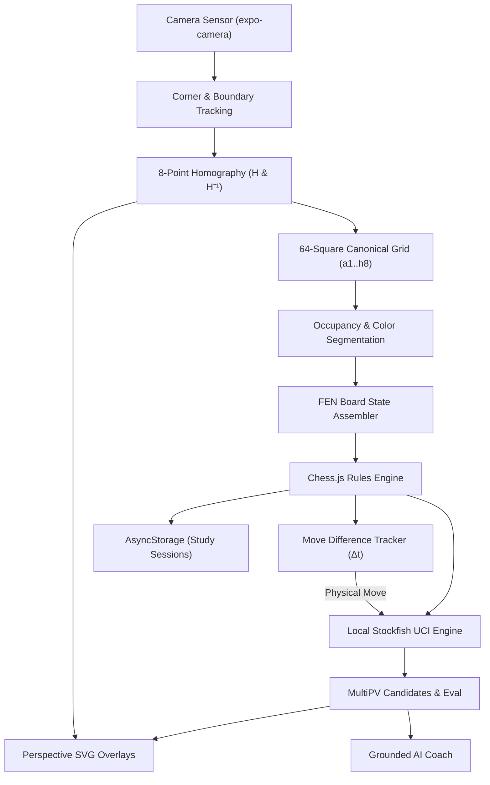

# CheckmateAR — Technical Architecture Document

## 1. Overview
CheckmateAR is an offline-first mobile application built with React Native and TypeScript that transforms any physical chessboard into an augmented reality coaching environment.

## 2. Computer Vision & Homography Math
Given 4 physical board corner coordinates $C_{src} = [P_0, P_1, P_2, P_3]$ in camera screen pixels:
1. Canonical space is defined as an $800 \times 800$ square with origin $(0, 0)$.
2. The $3 \times 3$ projective homography matrix $H$ is computed via Direct Linear Transformation (DLT) with Gaussian elimination and partial pivoting.
3. Every canonical tile $S_{col, row}$ has 4 vertices $[(c \cdot 100, r \cdot 100), \dots]$.
4. The forward transform $P_{screen} = H \cdot P_{canonical}$ projects each tile's corners and center onto the camera screen with true perspective foreshortening.

## 3. Piece & Color Detection Pipeline
1. **Occupancy**: Evaluates high-frequency gradient variance on each square patch against empty baseline.
2. **Color Segmentation**: Luminance histogram analysis ($L^* > 140$ classified as White, $L^* < 140$ classified as Black).
3. **Piece Typing**: Asymmetry ratio (detecting Knight snouts/ears), height-to-width ratio (King/Queen vs Pawns), and cross/crown finials.
4. **Validation**: Enforces legal piece counts and standard chess rules via `chess.js`.

## 4. Augmented Reality Overlays
1. **Board Border**: Neon cyan polygon (`#00E5FF`) with corner reticle brackets.
2. **Tile Highlights**: 4-point perspective polygons filled with glowing emerald (`#00E676`).
3. **Move Arrows**:
   - Straight moves: Linear vector with perspective arrow head.
   - Knight moves: L-shaped polyline with rounded fillet through canonical bend point (e.g. $g8 \to g6 \to f6$).
4. **Floating Eval Pill**: Positioned directly above destination square showing notation and score (e.g. `Nf6 +0.26`).
5. **Top HUD**: Real-time evaluation, depth, and checkmate status.

## 5. Offline & Privacy Design
- 100% of image processing, chess engine calculation, and coaching advice runs on the local device.
- No network connections, telemetry, or remote LLM calls required.
